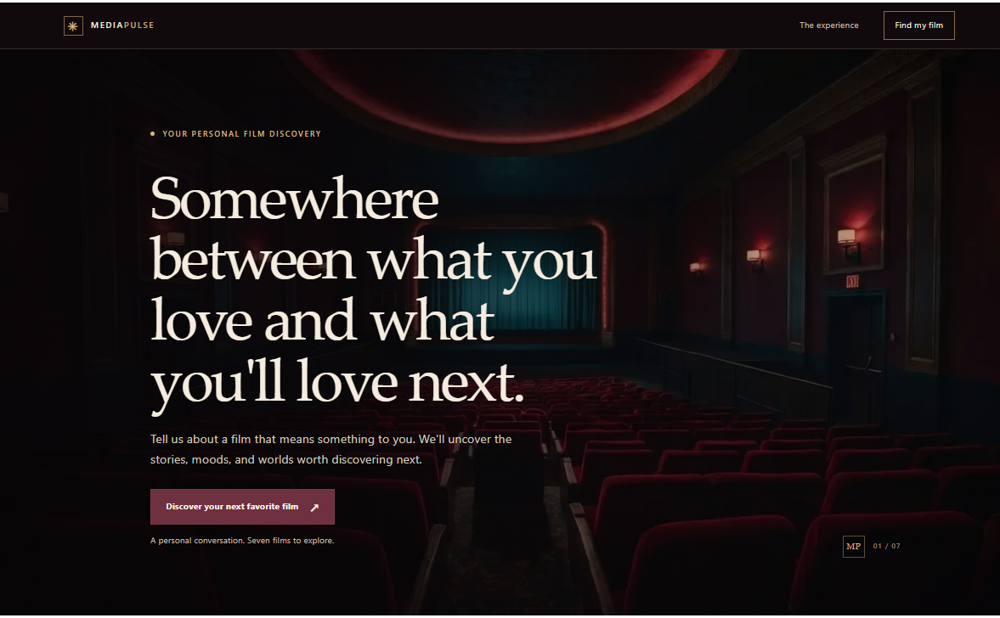
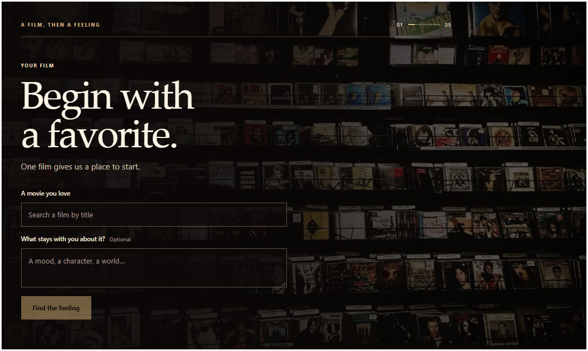
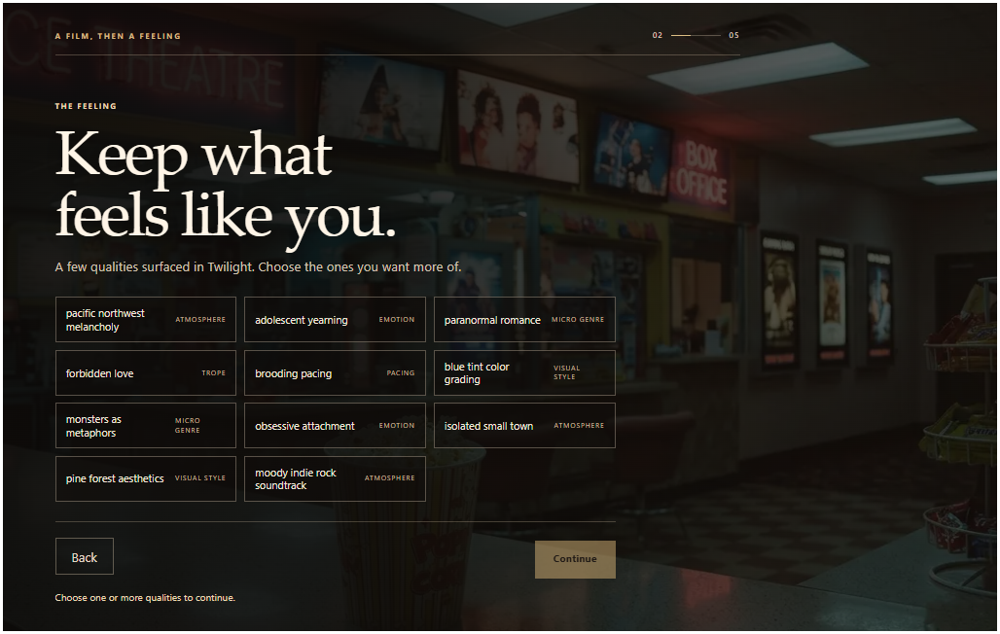
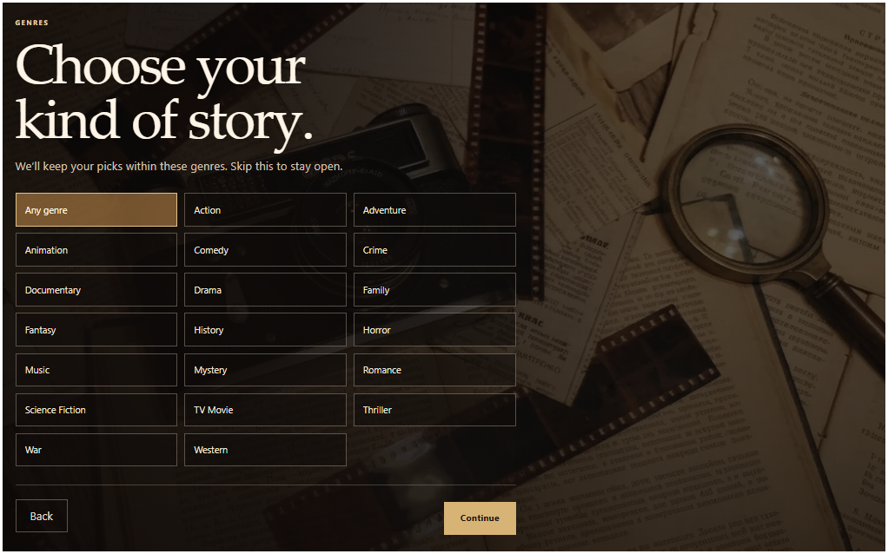
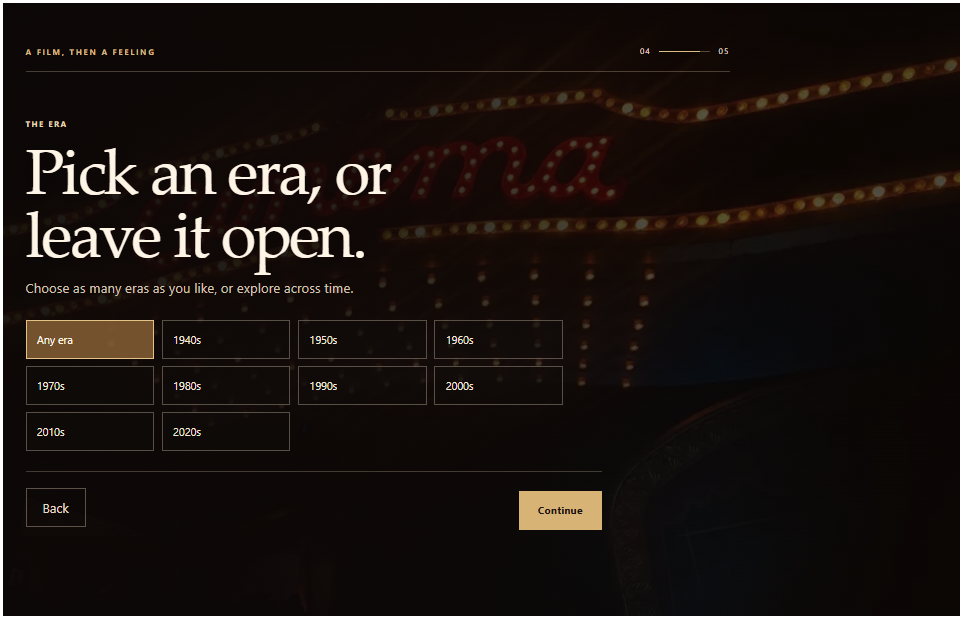
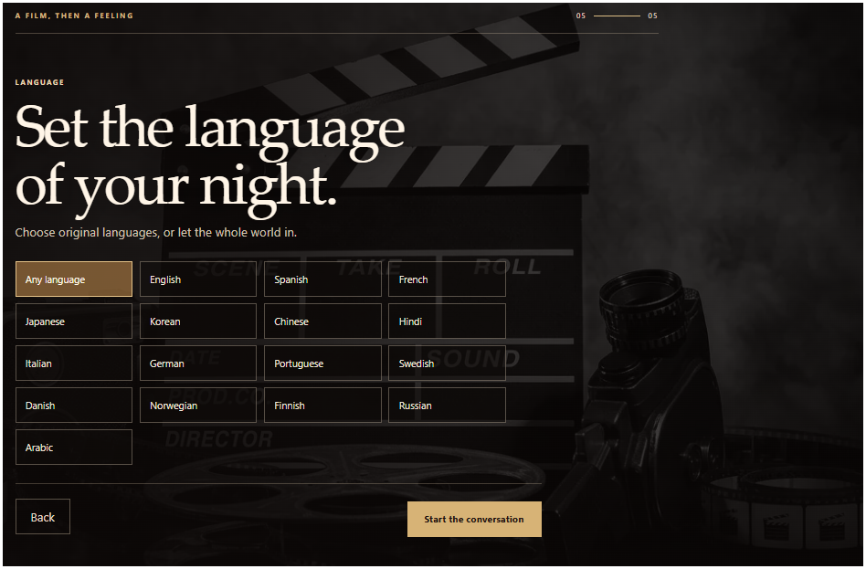
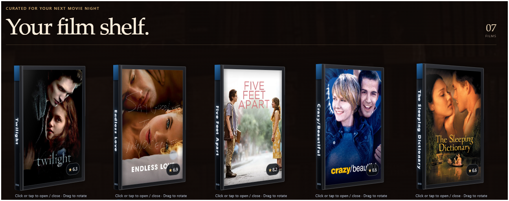
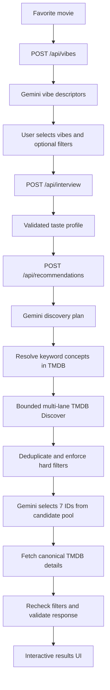

# MediaPulse

<p align="center">
  
</p>

<p align="center">
  <strong>Find the films that feel like you.</strong><br />
  An AI-assisted movie discovery experience built around your taste, not another endless list of trending titles.
</p>

<p align="center">
  <a href="https://mediapulse-movie.vercel.app/">Live demo</a> ·
  <a href="#how-it-works">How it works</a> ·
  <a href="#architecture">Architecture</a> ·
  <a href="#run-locally">Run locally</a>
</p>

<p align="center">
  
  
  
  
  
</p>

MediaPulse starts with a movie you love, learns what you respond to through a short adaptive interview, and builds a set of **seven personalized recommendations**. The goal is not to ask an AI to invent a list of films and hope for the best. It is to use AI to interpret taste while keeping movie discovery, eligibility, and final metadata grounded in TMDB.

> **The core design decision:** Gemini interprets taste and chooses among candidates. TMDB provides the catalog and canonical movie data. Application code enforces the rules between them.

## The experience

### From one favorite movie to a personal taste profile

<p align="center">
  
</p>

Start with an anchor movie and, optionally, a note about what makes it work for you. Gemini proposes more specific vibe descriptors than broad genre labels alone can capture. Pick the descriptors that fit, add any hard preferences, then answer a few questions that adapt to your previous responses.

<p align="center">
  
</p>

<p align="center">
  
</p>

<p align="center">
  
</p>

<p align="center">
  
</p>

### Recommendations you can actually explore

<p align="center">
  
</p>

The results page presents a taste/personality summary and seven film cases. The cases use CSS 3D transforms, with opening and closing behavior and pointer-driven rotation, alongside movie details and a personalized explanation of each match.

<p align="center">
  
</p>

## How it works

1. **Anchor movie:** the user enters a favorite film and can add context about why they like it.
2. **Vibe discovery:** Gemini generates roughly 10–15 selectable descriptors for that movie.
3. **Preference setup:** the user selects vibes and can optionally constrain genre, release decade, and original language.
4. **Adaptive interview:** Gemini asks one question at a time based on the current answers. The flow takes at least two and at most five answers.
5. **Candidate discovery:** the backend turns the taste profile into a structured discovery plan and searches TMDB within explicit limits.
6. **Constrained selection:** Gemini chooses seven unique movie IDs only from the eligible candidate pool.
7. **Verification and presentation:** TMDB supplies canonical details for the selected films, hard filters are checked again, and the results page renders the collection.

## Architecture



The main boundaries are intentional:

- **Gemini is the interpreter, not the catalog.** It creates descriptors, asks adaptive questions, plans discovery, and ranks eligible candidates. It cannot introduce arbitrary film IDs into the final selection.
- **TMDB is the source of movie records.** Keyword concepts are resolved through TMDB's keyword catalog, and the final selected films are fetched again for canonical metadata.
- **Application code is the rule enforcer.** Input/output schemas, candidate-pool membership, deduplication, hard filters, and response validation are handled outside the model.

## Engineering decisions

### AI recommendations with deterministic boundaries

Free-form model output is useful for interpreting subjective taste, but it is a poor place to enforce catalog integrity. Gemini returns structured plans and selections; the application validates those outputs and limits final choices to known candidate IDs. Invalid final selections receive one retry, not an open-ended loop.

### Hard preferences stay hard

Selected genres use **AND semantics**: a movie must contain every selected genre ID, though it can contain additional genres. Each selected decade is treated as its own era. A selected language must match TMDB's `original_language`. Filters are reapplied after discovery and after canonical details are fetched. If the search cannot find seven eligible movies within its budget, the API returns an insufficient-results error instead of quietly weakening the user's preferences.

### Bounded search instead of unbounded API churn

Discovery has explicit resource limits:

| Guardrail | Limit |
| --- | ---: |
| TMDB Discover requests | 24 maximum |
| Pages per planned query | 6 maximum |
| Validated discovery lanes | 8 maximum |
| Candidate pool target | 100 movies |
| Candidate pool ceiling | 160 movies |
| Invalid final selection retries | 1 |

Keyword concepts are accepted only when the resolved TMDB catalog label matches the planned label exactly, ignoring case. Candidate discovery is ordered by release date or original title rather than popularity or rating. Ratings and vote counts can appear as metadata, but do not decide eligibility, discovery order, or Gemini's final choices.

### Deliberate visual implementation

The DVD cases are built with CSS 3D transforms and pointer interactions rather than a WebGL scene or a separate 3D engine. That keeps the interaction within the existing web UI stack while still giving the results page a tactile, cinema-collection feel.

### Validate at the boundaries

The API uses Zod to validate incoming JSON and structured Gemini output. Product routes return consistent `{ error: { code, message } }` errors, and provider credentials remain on the server rather than being exposed through `NEXT_PUBLIC_` variables.

## Tech stack

| Technology | What it does here |
| --- | --- |
| Next.js 16 / App Router | Application pages and server-side API routes |
| React 19 | Interactive interview and recommendation UI |
| TypeScript | Typed application contracts and data flow |
| Tailwind CSS 4 + CSS Modules | Utilities, shared styling, and component-specific presentation |
| Zod 4 | Runtime validation for API and model-output boundaries |
| Google Gemini (`@google/genai`) | Vibe extraction, adaptive interviewing, discovery planning, and constrained selection |
| TMDB API | Movie discovery, keyword catalog, canonical metadata, and artwork |
| Node.js test runner | Automated tests for routes, schemas, providers, and recommendation orchestration |

## API overview

| Method | Endpoint | Responsibility |
| --- | --- | --- |
| `GET` | `/api/health` | Basic service health response |
| `POST` | `/api/vibes` | Validate the anchor movie and return vibe descriptors |
| `POST` | `/api/interview` | Continue the adaptive interview or return the completed taste profile |
| `POST` | `/api/recommendations` | Discover candidates, enforce filters, select and verify seven films |

## Run locally

### Requirements

- Node.js and npm
- A [Google Gemini API key](https://ai.google.dev/)
- A [TMDB API key](https://developer.themoviedb.org/docs)

### Setup

```bash
git clone https://github.com/iamsaaddar/mediapulse.git
cd mediapulse
npm install
```

Create `.env.local` in the project root:

```env
GEMINI_API_KEY=your_gemini_api_key
TMDB_API_KEY=your_tmdb_api_key
```

Then start the development server:

```bash
npm run dev
```

Open [http://localhost:3000](http://localhost:3000). `.env.example` contains placeholder values. Keep real credentials out of Git and never expose them through `NEXT_PUBLIC_` variables.

## Tests and checks

```bash
npm test           # Node's built-in test runner
npm run lint       # ESLint
npx tsc --noEmit   # TypeScript check
npm run build      # Production build
npm run start      # Serve a successful production build
```

The automated tests cover API contracts, schemas, Gemini prompts/client behavior, TMDB discovery and verification, and recommendation orchestration. Passing automated checks does not replace browser QA across mobile and desktop sizes or checks involving live provider quotas and the hosted deployment.

## Project structure

```text
app/                  App Router pages and API routes
components/
  landing/            Landing page experience
  interview/          Taste setup and adaptive interview
  results/             Personality summary and interactive DVD cases
  ui/                  Shared interface components
services/
  gemini/              Gemini client and prompt/workflow logic
  tmdb/                TMDB client, search, and canonical details
  recommendations/     Candidate planning, filtering, and orchestration
schemas/               Runtime validation schemas
types/                 TypeScript types
lib/                   Environment, validation, API, and utility helpers
constants/ config/     Supported options, limits, and provider settings
assets/                README screenshots and DVD-case demonstration GIF
```

The production DVD case implementation lives in `components/results/MovieCard.tsx` and `components/results/results.module.css`.

## Current scope and limitations

- The recommendation history is not persisted, so duplicate avoidance only applies within one response.
- There are no user accounts, database, or persistent taste profiles yet.
- A shareable personality card is not currently part of the results flow.
- Results depend on Gemini and TMDB availability, quotas, and the candidate pool that satisfies the selected filters. MediaPulse does not relax those filters to force seven results.
- The live demo link is provided for exploration; its presence in this README is not a guarantee of current uptime.

## Credits and attribution

- [Google Gemini](https://ai.google.dev/) powers the taste interpretation and adaptive AI steps.
- [The Movie Database (TMDB)](https://www.themoviedb.org/) provides movie discovery, metadata, and artwork.

This product uses the TMDB API but is not endorsed or certified by TMDB. Movie data and artwork are subject to TMDB's applicable terms and attribution requirements.

**Developer:** [IAMSAADDAR](https://github.com/iamsaaddar) · [Live demo](https://mediapulse-movie.vercel.app/)
